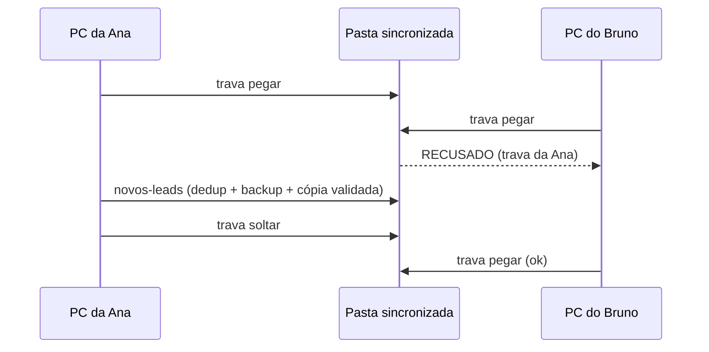

# shared-sheet-lock-cli

CLI em Python para **duas pessoas (dois PCs) trabalharem na mesma planilha** em uma pasta sincronizada (Google Drive, OneDrive, Dropbox) sem corromper nem sobrescrever o trabalho uma da outra. Foi extraído de um fluxo real de prospecção com agentes de IA que gravavam leads na mesma planilha mestre.

Todos os dados de exemplo são **fictícios**.

## O que resolve

| Problema | Solução |
|---|---|
| Duas pessoas rodando a mesma coleta ao mesmo tempo | **Trava de rodada** com validade (4 h): só quem pegou a trava grava |
| Mesmo negócio entrando duas vezes | **Deduplicação** por nome+cidade, telefone (últimos 10 dígitos) e domínio do site |
| Serviço de nuvem cria "cópia em conflito" | Recusa gravar enquanto existir cópia em conflito |
| Planilha aberta no Excel | Detecta o arquivo `~$` e recusa gravar |
| Arquivo mudou entre a leitura e a gravação | Compara tamanho e data (carimbo) e pede para rodar de novo |
| Gravação interrompida corrompe o arquivo | Grava num temporário, **valida** e só então copia; **backup do dia** automático |
| Dois PCs gerando o mesmo ID | **Faixa de IDs** por pessoa (Ana: L0001+, Bruno: L5001+) |
| Duas pessoas escolhendo a mesma região | **Mapa de áreas** (CSV) com reserva e "descanso" de áreas que repetiram leads |



## Instalação

```bash
pip install -r requirements.txt
python exemplo/gerar_exemplo.py        # cria exemplo/dados/ com planilha e mapa fictícios
cp sheetlock.local.json.example sheetlock.local.json   # diga quem é você e onde está a pasta
```

`sheetlock.local.json` (por PC, **não versionado**):

```json
{"quem": "Ana", "pasta": "C:/caminho/da/pasta/sincronizada"}
```

Também funciona por variáveis `SHEETLOCK_QUEM` e `SHEETLOCK_PASTA`.

## Uso

```bash
python sheetlock.py diagnostico
python sheetlock.py trava pegar FL-ORLANDO
python sheetlock.py novos-leads novos.json      # lista de objetos {"Empresa": ..., "Cidade": ..., "Telefone": ...}
python sheetlock.py procurar "cafe aurora"
python sheetlock.py atualizar L0001 "Status=Contatado"
python sheetlock.py areas
python sheetlock.py reservar MA-BOSTON
python sheetlock.py descansar NJ-NEWARK 90
python sheetlock.py trava soltar
python sheetlock.py --teste ./tmp novos-leads novos.json   # trabalha numa cópia
```

## Testes

```bash
python -m pytest -q
```

Cobrem: trava entre dois usuários, deduplicação, recusa com cópia em conflito, backup do dia e reserva de área.

## Licença

MIT
